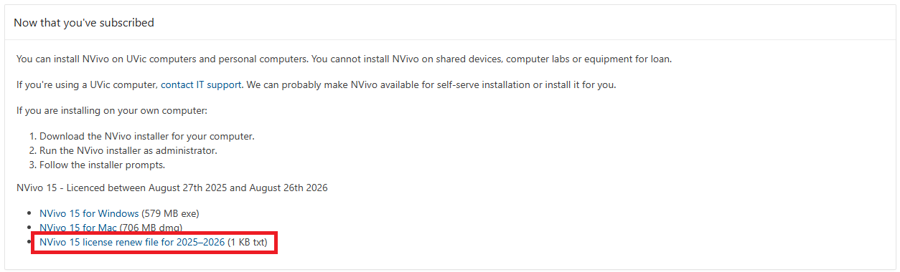
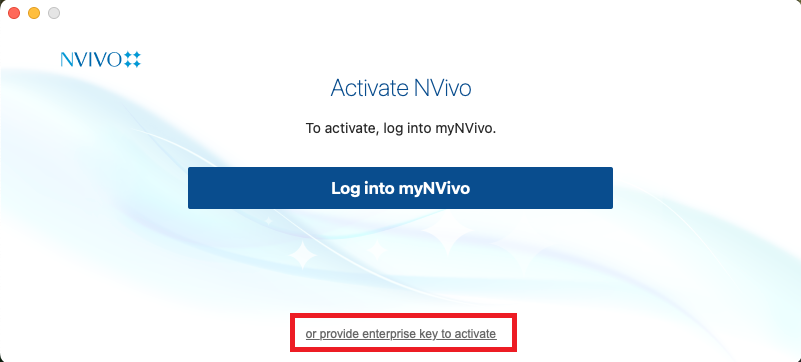

## Pre-Workshop Videos & Activities
This workshop is primarily hands-on practice with NVivo in order to learn to use key features of the software. To participate fully please do the following **before the workshop**:

- **REQUIRED:** Install NVivo on your computer:
  - You can download an NVivo trial version by [following this link.](https://lumivero.com/resources/free-trial/nvivo/){:target="_blank"}  
 **-OR-**  
  - UVic graduate students, faculty, and staff can access NVivo through the [Online Services Portal](https://onlineservices.uvic.ca/).
  - To activate NVivo:
     - In **Online Services**, expand “**NVivo – Status: Active”** under **Your Services**.
     - Click **Manage**.
     - Download the **NVivo 15 licence file**. If you have not already installed NVivo 15, download and install the appropriate Mac or Windows version.
    
     - Open **NVivo 15**.
     - If the Activate NVivo window appears, select “or provide enterprise key to activate.”
     - Enter the licence key provided in the NVivo 15 licence file.
    

- **OPTIONAL:** [Introduction to NVivo](https://www.youtube.com/watch?v=QNjEygXM_bE){:target="_blank"} video (7 min) 
<iframe width="560" height="315" src="https://www.youtube.com/embed/QNjEygXM_bE" title="YouTube video player" frameborder="0" allow="accelerometer; autoplay; clipboard-write; encrypted-media; gyroscope; picture-in-picture" allowfullscreen></iframe>

[NEXT STEP: Introduction to Hands-On Activities](activities-intro.html){: .btn .btn-blue }
